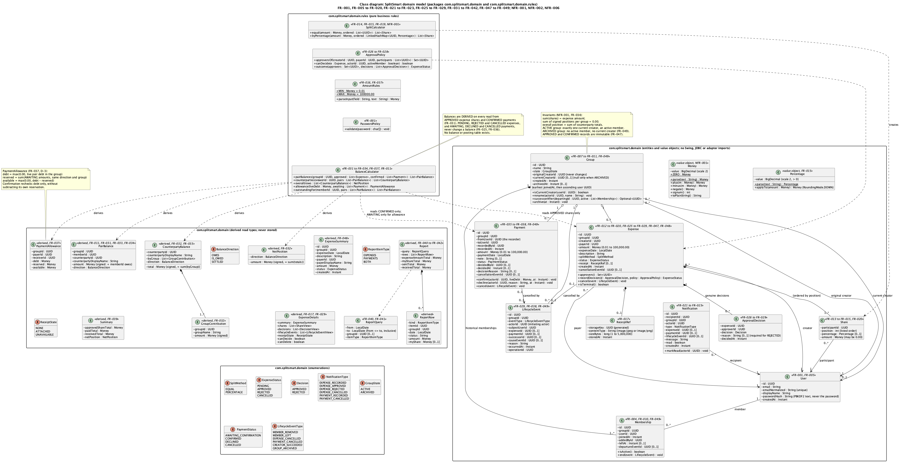
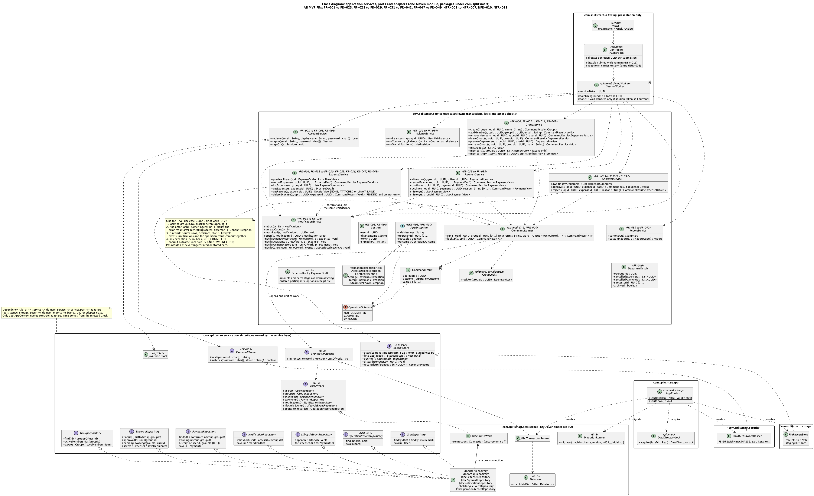
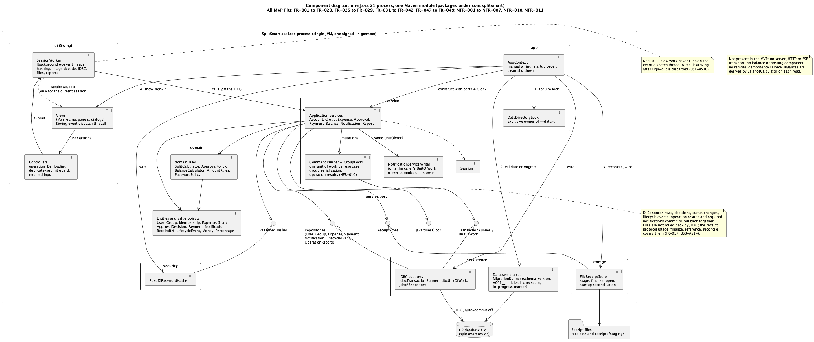
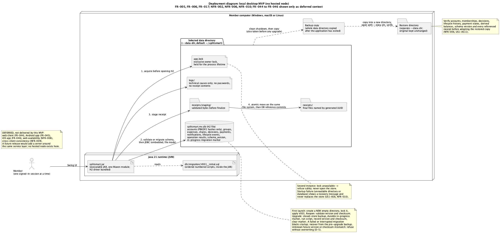
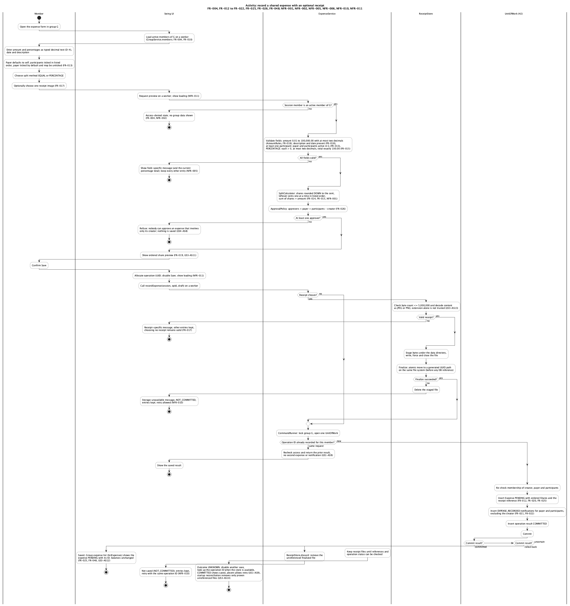
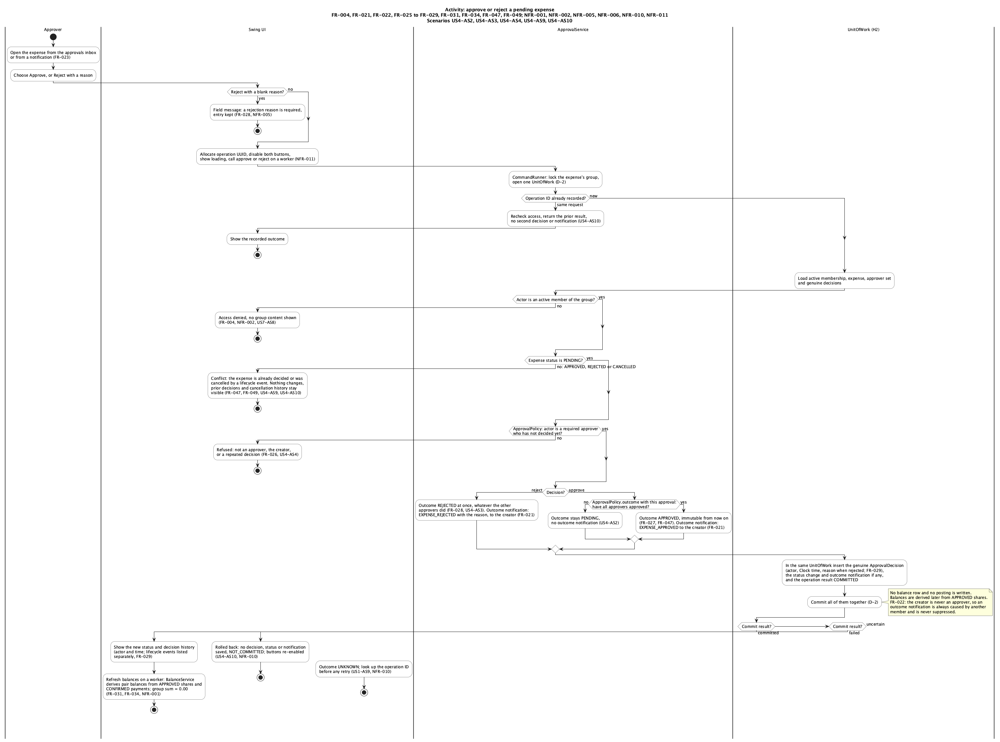
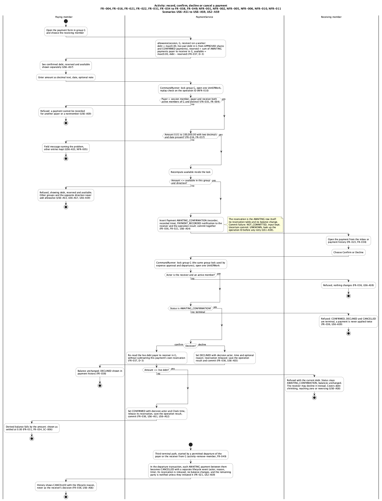
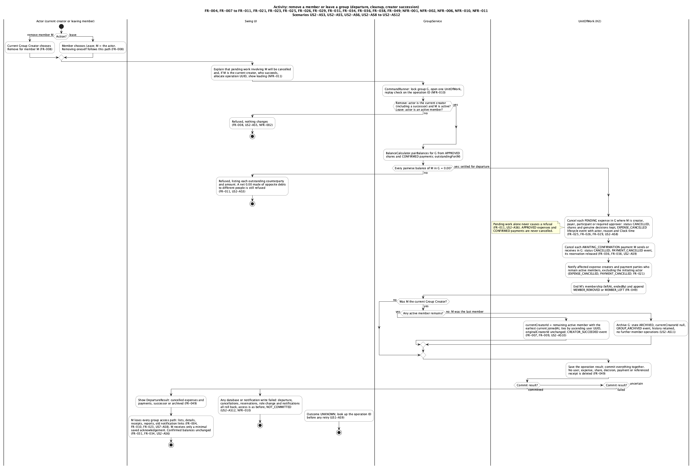
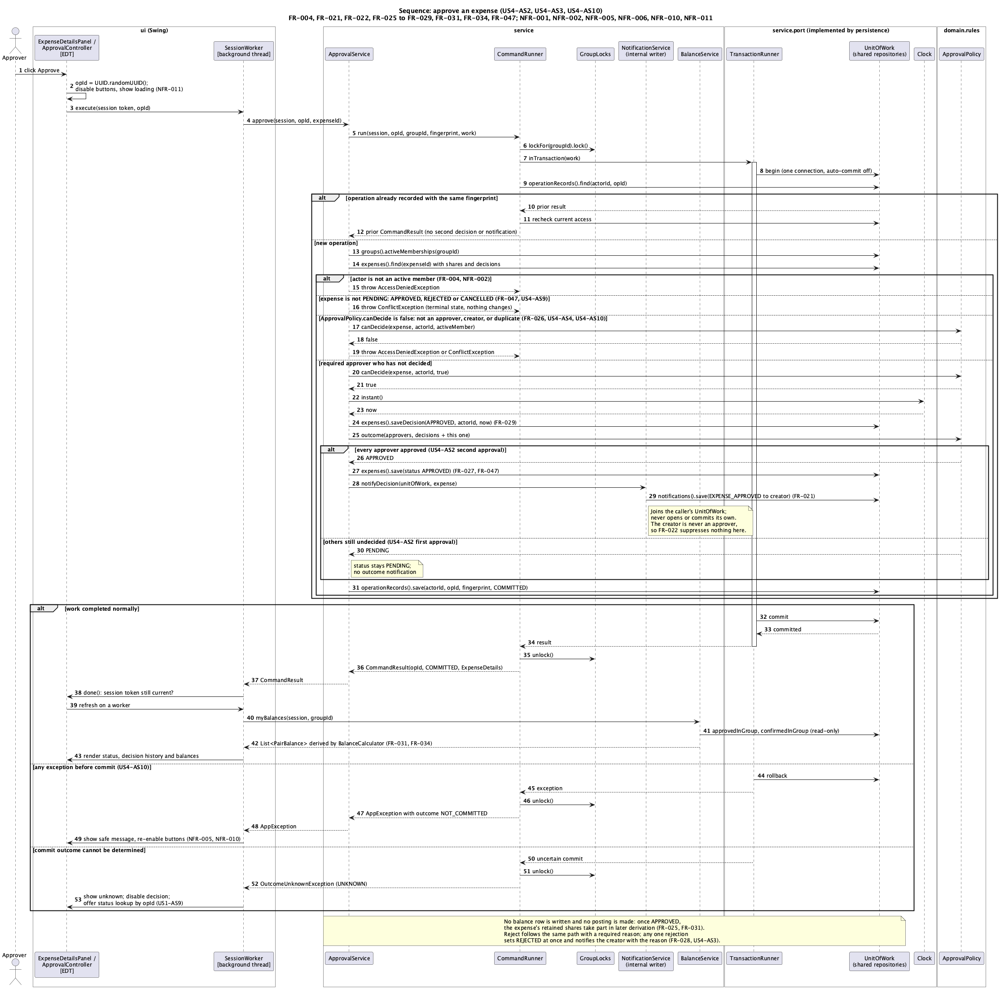

# SplitSmart Design Document

**Date**: 2026-11-05 | **Project**: SplitSmart, CIS 285 | **Status**: Reviewed

**Controlling decision**: [ADR-001](../architecture/decision.md), Architecture A (layered Java 21
Swing desktop monolith over embedded H2) with D-1 through D-5 adopted from Architecture B.

**Related documents**: [constitution](../../.specify/memory/constitution.md),
[spec.md](../../specs/001-splitsmart-expense-sharing/spec.md),
[plan.md](../../specs/001-splitsmart-expense-sharing/plan.md),
[research.md](../../specs/001-splitsmart-expense-sharing/research.md),
[data-model.md](../../specs/001-splitsmart-expense-sharing/data-model.md),
[service-api.md](../../specs/001-splitsmart-expense-sharing/contracts/service-api.md),
[ui-screens.md](../../specs/001-splitsmart-expense-sharing/contracts/ui-screens.md),
[quickstart.md](../../specs/001-splitsmart-expense-sharing/quickstart.md),
[consolidation instructions](../architecture/consolidation-instructions.md).

## 1. Purpose and scope

This document is the design for the SplitSmart desktop MVP. It explains how the requirements in
the specification are realized by classes, packages, transactions, files, and screens, and it
maps every requirement to the diagram element, responsible class, and planned JUnit test that
will verify it.

Scope:

- **In scope**: the 43 MVP functional requirements (FR-001 to FR-023, FR-025 to FR-029, FR-031 to
  FR-042, FR-047 to FR-049) and the MVP non-functional requirements (NFR-001 to NFR-007, NFR-010,
  NFR-011), delivered as one local Java 21 Swing process in one Maven module over embedded H2 and
  local receipt files, with manual dependency wiring and one signed-in member at a time.
- **Deferred, kept visible**: FR-024 (push or email notifications), FR-030 (multi-level approval),
  FR-043 (report export), FR-044 to FR-046 (web, Android, iOS), NFR-008 and NFR-009. Desktop
  delivery does not satisfy web, Android, or iOS delivery.
- **Not adopted** (per ADR-001): a server, HTTP or SSE transport, a ledger table or any monetary
  posting component, PostgreSQL, Javalin, Jackson, Flyway, Testcontainers, and a multi-module
  build. Balances are derived only from Approved expense shares and Confirmed payments.

Status of statements in this document:

- The 2026-11-05 lifecycle, receipt, payment-availability, and operational clarifications in the
  specification were decided by the project owner during consolidation, together with ADR-001
  (D-1 to D-5).
- Every class and test name below that does not yet exist in source is **planned**. No JUnit test
  has been written or executed for this design revision, no timing has been measured, and no
  review has been recorded. A "Planned JUnit test" entry is a verification obligation, not a
  result.

## 2. Domain responsibilities and invariants

Package `com.splitsmart.domain` holds encapsulated entities and value objects;
`com.splitsmart.domain.rules` holds the pure business rules. Neither imports Swing, AWT, JDBC, or
an adapter package (constitution Principle III). The class model is shown in
[class-domain](#61-class-domain).

| Type | Responsibility | Requirements |
|------|----------------|--------------|
| `User` | account identity: email (normalized unique), display name, PBKDF2 hash text only | FR-001, FR-005 |
| `Group` | name, `GroupState` ACTIVE/ARCHIVED, `originalCreatorId` (never changes), nullable `currentCreatorId`; renames and successor selection | FR-007 to FR-011, FR-049 |
| `Membership` | one historical membership period: join time, added by, leave time, departure event | FR-004, FR-010, FR-049 |
| `Expense` | source record with status PENDING/APPROVED/REJECTED/CANCELLED, ordered shares, genuine decisions, optional receipt, cancellation event reference | FR-012 to FR-020, FR-025 to FR-029, FR-047 to FR-049 |
| `Share` | one participant's position, optional percentage, and amount (may be 0.00) | FR-013 to FR-015, FR-020 |
| `ApprovalDecision` | one genuine approve or reject by one approver with Clock time and reason | FR-026 to FR-029 |
| `Payment` | source record with status AWAITING_CONFIRMATION/CONFIRMED/DECLINED/CANCELLED, recorder and receiver-decision fields kept separate from lifecycle cancellation | FR-035 to FR-038, FR-049 |
| `Notification` | recipient, group, actor, `NotificationType`, link to expense, payment, or lifecycle event, read flag | FR-021 to FR-023 |
| `LifecycleEvent` | append-only system event (removal, leave, expense or payment cancellation, creator succession, archive) with initiating actor, subject, reason, time, operation ID | FR-029, FR-038, FR-049 |
| `ReceiptRef` | generated UUID storage key, actual content type, exact byte count, stored time; never a user path | FR-017 |
| `Money`, `Percentage` | `BigDecimal` scale 2, parsed only from decimal strings (D-4), explicit `RoundingMode` | NFR-001 |
| `SplitCalculator` | equal and percentage splits, rounding down to the cent, leftover cents one at a time in listed order | FR-014, FR-015, FR-019 |
| `ApprovalPolicy` | approver set = payer plus participants minus creator; who may decide; outcome (any reject = REJECTED, all approve = APPROVED) | FR-026 to FR-028 |
| `BalanceCalculator` | pair balances, counterparty aggregation, overall `NetPosition`, `PaymentAllowance`, outstanding pairs for departure | FR-011, FR-031 to FR-034, FR-037 |
| `AmountRules` | 0.01 to 100,000.00 with at most two decimals for expense and payment input | FR-016, FR-037 |
| `PasswordPolicy` | at least 8 characters with a letter and a digit | FR-001 |

Derived read types (never stored): `PairBalance`, `CounterpartyBalance` with `GroupContribution`
rows, `NetPosition`, `PaymentAllowance(debt, reserved, available)`, `ExpenseSummary`,
`ExpenseDetails`, `Summary`, `Report`, `ReportQuery`. Sign convention: a positive amount means the
viewing member owes; a negative amount means the viewing member is owed.

Invariants (each has a planned test in [section 8](#8-acceptance-matrix)):

1. The shares of an expense sum exactly to its amount; percentages total exactly 100.00 (FR-014,
   FR-015, NFR-001).
2. For every group, the signed positions of all members sum to exactly 0.00 (FR-034).
3. Balances use only APPROVED expense shares and CONFIRMED payments. PENDING, REJECTED, and
   CANCELLED expenses and AWAITING_CONFIRMATION, DECLINED, and CANCELLED payments never change a
   balance (FR-025, FR-031, FR-036). No ledger, balance table, or posting exists.
4. Reservations are derived from AWAITING_CONFIRMATION rows of the same group and direction:
   `debt = max(0.00, live pair debt)`, `reserved = sum(awaiting amounts)`,
   `available = max(0.00, debt - reserved)`. Recording checks `available`; confirmation rechecks
   `debt` without subtracting its own reservation (FR-037, D-3).
5. An ACTIVE group has exactly one current creator who is an active member; an ARCHIVED group has
   no active member and no current creator. The original creator is retained (FR-007, FR-049).
6. APPROVED expenses and CONFIRMED payments are immutable and are never cancelled (FR-047).
   Only PENDING expenses and AWAITING_CONFIRMATION payments may be cancelled, and only by a
   permitted departure (FR-049).
7. At most one genuine decision exists per expense and approver. A lifecycle cancellation is
   recorded as a `LifecycleEvent`, never as an approver's or receiver's decision (FR-028, FR-029).
8. The overall position equals the sum of the counterparty totals, grouped by user ID (FR-032).
9. Departure is permitted only when every pairwise balance of the departing member in the group
   is 0.00; a scalar net 0.00 formed from opposite debts is insufficient (FR-011).

## 3. Package and port dependency rules

All packages are under `com.splitsmart` in one Maven module (D-1). The rule is enforced by a
planned architecture test (`LayerDependencyTest`, see NFR-007).

```text
ui --> service --> domain (and domain.rules)
service --> service.port <-- persistence, storage, security (adapters)
app --> everything (manual wiring in AppContext only)
```

| Package | Contents | May import | Must not import |
|---------|----------|------------|-----------------|
| `app` | `Main`, `AppContext`, `AppPaths`, `DataDirectoryLock` | all packages | |
| `ui` | Swing views, `*Controller`, `SessionWorker` | `service`, `domain` read types | `service.port`, adapters, `java.sql` |
| `service` | the eight services, `Session`, `CommandRunner`, `CommandResult`, `OperationOutcome`, `GroupLocks`, `AppException` family, drafts and DTOs | `domain`, `service.port`, `java.time.Clock` | `ui`, adapters, `javax.swing`, `java.sql` |
| `service.port` | `TransactionRunner`, `UnitOfWork`, `UserRepository`, `GroupRepository`, `ExpenseRepository`, `PaymentRepository`, `NotificationRepository`, `LifecycleEventRepository`, `OperationRecordRepository`, `ReceiptStore`, `PasswordHasher` | `domain` | adapters, `ui` |
| `domain`, `domain.rules` | entities, value objects, enums, derived types, rules | JDK only | `javax.swing`, `java.awt`, `java.sql`, every other SplitSmart package |
| `persistence` | `Database`, `MigrationRunner`, `JdbcTransactionRunner`, `JdbcUnitOfWork`, `Jdbc*Repository` | `service.port`, `domain` | `ui`, concrete services |
| `storage` | `FileReceiptStore` | `service.port`, `domain` | `ui`, concrete services |
| `security` | `Pbkdf2PasswordHasher` | `service.port` | `ui`, concrete services |

Time is read only from the injected `java.time.Clock` (system UTC clock in `AppContext`, fixed clock
in tests).

## 4. Transaction and serialization ownership (D-2)

- **One use case, one unit of work.** Each public mutating service method is one top-level use
  case. It runs through `CommandRunner.run`, which (1) obtains the group lock from `GroupLocks`,
  (2) opens one `UnitOfWork` through `TransactionRunner`, (3) checks the actor-scoped operation ID,
  (4) runs the use case, (5) saves the operation result, and (6) commits, then releases the lock.
- **What commits together.** Source records, ordered shares, genuine decisions, status changes,
  lifecycle events, operation results, and every required notification row commit or roll back as
  one unit. Repositories are obtained from the same `UnitOfWork` and share one JDBC connection
  with auto-commit off. `NotificationService` internal writer methods receive the caller's
  `UnitOfWork`; they never open a transaction or commit.
- **No artificial transactions.** Share previews, sign-out, and other pure or in-memory operations
  open no database transaction. Read-only queries use a read-only unit of work.
- **Serialization policy.** One process owns the data directory through `DataDirectoryLock`. Every
  group mutation (expense creation and deletion, approval and rejection, payment recording,
  confirmation and decline, member addition, removal, leaving, renaming, and lifecycle cleanup)
  holds that group's lock from before the unit of work opens until commit or rollback completes.
  Background workers call the same services and cannot bypass the lock. An operation needing
  several group locks takes them in ascending group UUID order. Optimistic row version fields are
  not used: a row version cannot protect a derived debt. The design does not claim support for
  simultaneous remote users; a future server needs a new isolation review.
- **Files are not rolled back by JDBC.** Receipts follow the protocol in section 5.1.

## 5. Receipt, migration, and recovery design

### 5.1 Receipt protocol (FR-017, NFR-010, US3-AS13, US3-AS14)

1. `ReceiptStore.stage` checks the byte count (at most 5,000,000 bytes, inclusive) and decodes the
   content as JPEG or PNG; a filename extension is never trusted. Invalid input raises a
   receipt-specific `ValidationException` and other entries are retained. No attachment is valid.
2. Valid bytes are written under `receipts/staging/` in the selected data directory, forced to
   disk, and closed.
3. `ReceiptStore.finalizeStaged` moves the file atomically to `receipts/<uuid>` on the same file
   system before any database reference exists. If atomic move is unsupported, the save is refused
   with `StorageUnavailableException` rather than acknowledged unsafely.
4. The expense, ordered shares, `ReceiptRef`, notifications, and operation result are written in
   one unit of work. Success is reported only after commit.
5. After a known rollback, the staged or finalized file is discarded. After an uncertain commit,
   files are kept until references and the operation status can be checked.
6. On startup, under the exclusive lock and before new writes, `FileReceiptStore.reconcile`
   compares files with retained references, removes only proven unreferenced files, and reports a
   missing referenced file as receipt-unavailable. A database-open failure never authorizes file
   deletion. Rejected and cancelled expenses keep their receipts.
7. Viewing a receipt goes through `ExpenseService.getReceipt` with a membership check. A missing or
   unreadable file yields `ReceiptState.UNAVAILABLE` while the expense stays viewable.

### 5.2 Startup, schema versioning, and migration (D-5, NFR-006, NFR-010)

`AppContext.start(dataDir)` runs in this order: acquire `DataDirectoryLock` (a second instance is
refused safely); open H2; `MigrationRunner` validates or migrates; reconcile receipts; wire
services; show sign-in.

- **First launch**: create a new empty directory, take the lock, apply `V001__initial.sql`, record
  version and checksum in `schema_version`. An interrupted first initialization may be restarted
  only in a verified new directory containing no user data.
- **Normal reopen**: validate the applied versions and checksums against the bundled scripts under
  `src/main/resources/db/migration/`.
- **Upgrade**: with the database closed and the lock still held, copy a coherent backup; durably
  record an in-progress marker; run the script; record version and checksum; clear the marker.
  H2 DDL can commit independently, so no whole-upgrade rollback is promised: a failed or
  interrupted migration blocks normal startup and requires recovery from the pre-upgrade backup.
- **Refusals**: an unknown future version or a checksum mismatch is refused without overwriting
  data. A startup failure shows a safe recovery message, shows no member data, and never replaces
  the store with an empty one (US1-AS8).

### 5.3 Operation outcomes and status recovery (NFR-010, US1-AS9)

- Controllers allocate a stable operation UUID per submission. `CommandRunner` stores an
  actor-scoped operation-result record with a fingerprint of non-secret command fields in the same
  unit of work as the result.
- A retry with the same ID and the same fingerprint returns the prior result after rechecking
  access; a different fingerprint is a `ConflictException`. A departed member receives only a
  minimal saved acknowledgement of their own departure, never a cached group payload.
- Every failure carries `OperationOutcome` NOT_COMMITTED, COMMITTED, or UNKNOWN. After UNKNOWN,
  further mutation is disabled until `CommandRunner.lookup` can read the store; absence after
  recovery permits a retry with the same ID. A committed write followed by a refresh failure
  remains saved.
- Registration does not use replay: after an uncertain result the member is offered ordinary
  sign-in with generic credential errors. Passwords and credential buffers are never persisted or
  fingerprinted.

### 5.4 Backup and restore (NFR-006, US1-AS11)

Back up only after the application has exited (workers finished, H2 closed): copy the whole data
directory, including database files, receipts, staging, and migration state. Restore into a
separate directory opened with `--data-dir`; keep the original unchanged. Verify accounts,
memberships, genuine decisions, lifecycle history, payment states, derived balances, schema
version, and every referenced receipt before adopting the restored copy.

## 6. Diagram index

Sources and rendered images are in [diagrams/](diagrams/). Each `.puml` has a PNG with the same
basename. Requirement IDs appear in each diagram's title and in stereotypes or notes beside the
realizing elements.

### 6.1 class-domain



Source: [class-domain.puml](diagrams/class-domain.puml). Shows the encapsulated entities (`User`,
`Group` with `originalCreatorId` and `currentCreatorId`, historical `Membership`, `Expense`,
ordered `Share`, genuine `ApprovalDecision`, `Payment`, `Notification`, `ReceiptRef`,
`LifecycleEvent`), all status enums with one value per line, the `Money` and `Percentage` value
objects, the derived read types (`PairBalance`, `CounterpartyBalance`, `GroupContribution`,
`NetPosition`, `PaymentAllowance`, `ExpenseSummary`, `ExpenseDetails`, `Summary`, `Report`,
`ReportQuery`), and the five rules. Notes state that balances are derived from APPROVED shares and
CONFIRMED payments with no ledger, the zero-sum and creator invariants, and the reservation
formula. Requirements: FR-001, FR-005 to FR-023, FR-025 to FR-029, FR-031 to FR-042, FR-047 to
FR-049; NFR-001, NFR-002, NFR-006.

### 6.2 class-services-ports



Source: [class-services-ports.puml](diagrams/class-services-ports.puml). Shows the eight
application services with their public signatures (including `listExpenses`,
`myCounterpartyBalances`, `allowance`, `removeMember`/`leaveGroup` returning `DepartureResult`,
and `CommandRunner.lookup` for status recovery), `Session`, `CommandResult`, `OperationOutcome`,
the `AppException` family, `GroupLocks`, the `service.port` interfaces and the injected `Clock`,
their JDBC, file-system, and PBKDF2 realizations, `AppContext` manual wiring, and the permitted
dependency arrows. Requirements: every MVP FR; NFR-001 to NFR-007, NFR-010, NFR-011.

### 6.3 component



Source: [component.puml](diagrams/component.puml). Shows the single process and module: Swing
views and controllers on the event dispatch thread, `SessionWorker` background threads, the
application services with `CommandRunner` and the shared-transaction notification writer, the
domain, the ports, the adapters, `AppContext` startup order (lock, migrate, reconcile, wire), and
the H2 file and receipt folders. A note states that no server, HTTP, SSE, or monetary posting
component exists. Requirements: every MVP FR; NFR-001 to NFR-007, NFR-010, NFR-011.

### 6.4 deployment



Source: [deployment.puml](diagrams/deployment.puml). Shows one member computer with a Java 21 JVM
running the executable JAR (migration scripts bundled), the selected data directory
(`--data-dir`, default `~/.splitsmart`) with `app.lock`, the H2 file including `schema_version` and
the migration marker, `receipts/` and `receipts/staging/`, and logs, plus the closed-application
backup and separate-directory restore. There is no hosted node; web, Android, and iOS appear only
in an explicitly deferred note. Requirements: FR-005, FR-006, FR-017; NFR-002, NFR-006, NFR-010;
FR-044 to FR-046 as deferred context only.

### 6.5 activity-record-expense



Source: [activity-record-expense.puml](diagrams/activity-record-expense.puml). Membership, field,
amount, participant, and percentage validation; payer default and untick; the ordered exact share
preview; the no-approver refusal (US4-AS8); receipt content and size validation, staging, and
finalization before the reference commits; one unit of work for the expense, shares, receipt
reference, notifications, and operation result; and the committed, rolled-back, and uncertain
outcomes with file handling and status lookup. The draft's independent receipt and database fork
is removed. Requirements: FR-004, FR-012 to FR-022, FR-025, FR-026, FR-048; NFR-001, NFR-002,
NFR-005, NFR-006, NFR-010, NFR-011.

### 6.6 activity-approve-expense



Source: [activity-approve-expense.puml](diagrams/activity-approve-expense.puml). Required reject
reason; replay check; active membership, PENDING status, and required-undecided-approver guards
with their refusals (US4-AS4, US4-AS9, US4-AS10); any rejection versus all approvals versus still
pending (US4-AS2, US4-AS3); decision, status, outcome notification, and operation result in one
commit on both branches; rollback and unknown outcomes; and the derived-balance refresh after
commit with no balance write. Requirements: FR-004, FR-021, FR-022, FR-025 to FR-029, FR-031,
FR-034, FR-047, FR-049; NFR-001, NFR-002, NFR-005, NFR-006, NFR-010, NFR-011.

### 6.7 activity-record-payment



Source: [activity-record-payment.puml](diagrams/activity-record-payment.puml). The session member
as payer, both parties active, amount and date validation, separate confirmed debt, reserved, and
available amounts (US6-AS7), the payment-plus-notification commit, receiver-only confirm or
decline under the shared group lock, the live-debt recheck with stale refusal and no transition
(US6-AS8), terminal and wrong-actor refusals (US6-AS9), decline releasing the reservation, and the
separate lifecycle-cancellation path started by a departure (FR-049, US2-AS9). Requirements:
FR-004, FR-016, FR-021, FR-022, FR-031, FR-034 to FR-038, FR-049; NFR-001, NFR-002, NFR-005,
NFR-006, NFR-010, NFR-011.

### 6.8 activity-remove-member



Source: [activity-remove-member.puml](diagrams/activity-remove-member.puml). Creator-authorized
removal versus self-leave; the every-pair-zero guard with the outstanding breakdown (US2-AS3);
successful removal despite pending work (US2-AS6); cancellation of affected PENDING expenses and
AWAITING payments with lifecycle events, released reservations, and notifications (US2-AS8,
US2-AS9); deterministic creator succession or final-member archive (US2-AS10, US2-AS11); retained
source records, revoked access, and one transaction with full rollback (US2-AS12). Requirements:
FR-004, FR-007 to FR-011, FR-021, FR-023, FR-025, FR-026, FR-029, FR-031, FR-034, FR-036, FR-038,
FR-049; NFR-001, NFR-002, NFR-006, NFR-010, NFR-011.

### 6.9 sequence-approve-expense



Source: [sequence-approve-expense.puml](diagrams/sequence-approve-expense.puml). Approver, Swing
controller, `SessionWorker`, `ApprovalService`, `CommandRunner`, `GroupLocks`, `TransactionRunner`,
the shared `UnitOfWork` repositories, `ApprovalPolicy`, `Clock`, the `NotificationService` writer
joining the same unit of work, and `BalanceService`. It shows replay, forbidden, terminal, and
duplicate alternatives, partial versus final approval, commit then UI and balance refresh, rollback
on failure, and the unknown outcome. No balance write, posting, or independent notification commit
occurs. Requirements: FR-004, FR-021, FR-022, FR-025 to FR-029, FR-031, FR-034, FR-047; NFR-001,
NFR-002, NFR-005, NFR-006, NFR-010, NFR-011; scenarios US4-AS2, US4-AS3, US4-AS10.

### 6.10 Rendering

PlantUML version **1.2025.4** with Graphviz `dot` 16.1.0, run on a Java runtime. From the
repository root:

```sh
java -jar /path/to/plantuml-1.2025.4.jar -tpng docs/design/diagrams/*.puml
```

Each PNG is written beside its source with the same basename. A nonzero exit status or an
"Error line" message is a failure. Every image is below PlantUML's default 4096-pixel size limit,
so no size override is needed. After rendering, inspect each PNG for readable labels, complete
branches, and agreement with its source. No source contains a ledger class, ledger repository,
ledger calculator input, or posting step.

## 7. Service-to-screen flows and error states

Every screen calls services through a controller and a `SessionWorker`; the event dispatch thread
only updates components, and a result is rendered only if the same session is still signed in
(NFR-011, US1-AS10). Business decisions stay in services and rules.

| Screen | Service calls | Empty state | Field errors (NFR-005) | Operational states (NFR-010) | Requirements |
|--------|---------------|-------------|------------------------|------------------------------|--------------|
| Login / Register | `AccountService.register`, `signIn`, `signOut` | none | generic sign-in failure; per-field registration errors | storage unavailable; uncertain registration offers sign-in | FR-001 to FR-003, FR-005 |
| Dashboard | `GroupService.myGroups`, `BalanceService.myCounterpartyBalances`, `myOverallPosition`, `NotificationService.unreadCount` | no groups: zero balances, create-group action | none | loading; storage unavailable with retry | FR-004, FR-023, FR-032, FR-033 |
| Group | `GroupService.members`, `addMember`, `renameGroup`, `previewDeparture`; `ExpenseService.listExpenses`; `BalanceService.myBalances`; `PaymentService.history(s, groupId)` | empty expense list; settled rows | email, name | access revoked; conflict (already member) | FR-004, FR-007 to FR-011, FR-031, FR-033, FR-048 |
| Departure dialog | `GroupService.previewDeparture`, `removeMember`, `leaveGroup` | none | none | not settled with outstanding rows; rolled back "nothing changed"; unknown with Check status | FR-008, FR-011, FR-049 |
| Expense form | `ExpenseService.previewShares`, `recordExpense` | none | amount, date, description, participants, percentage total, receipt | not saved, saved, unknown; duplicate submit disabled | FR-012 to FR-022, FR-025, FR-026 |
| Expense details | `ExpenseService.getExpense`, `getReceipt`, `deleteExpense`; `ApprovalService.approve`, `reject` | no receipt | rejection reason | receipt unavailable; terminal conflict; access revoked; unknown | FR-017, FR-026 to FR-029, FR-047, FR-049 |
| Approvals inbox | `ApprovalService.awaitingMyDecision` | nothing awaiting | none | loading; storage unavailable | FR-026 |
| Payment form | `PaymentService.allowance`, `recordPayment` | available 0.00 shown as nothing to pay | amount, date, note | over-available refusal with amounts; unknown | FR-035, FR-037 |
| Payments | `PaymentService.history`, `confirm`, `decline` | no payments | decline reason length | stale-debt refusal showing current debt; terminal conflict; unknown | FR-036 to FR-038 |
| Notifications | `NotificationService.inbox`, `markRead`, `open` | empty inbox, unread 0 | none | inaccessible link yields a safe no-access result | FR-021 to FR-023 |
| Reports | `ReportService.summary`, `customReport` | empty rows with 0.00 totals | date order, unauthorized group filter | loading; storage unavailable | FR-039 to FR-042 |

Error contract (shared by all screens): `ValidationException` (field and message, entries kept),
`AccessDeniedException`, `ConflictException` (stale or terminal state), `StorageUnavailableException`,
`ReceiptUnavailableException`, and `OutcomeUnknownException`, each with a safe message, operation ID
where applicable, retryability, and an `OperationOutcome`. Technical causes are logged locally
without passwords or receipt contents. Storage failure is never shown as invalid input.

## 8. Acceptance matrix

Every test name below is **planned**: none exists yet and none has been run. Test methods are
named with the requirement ID and display the scenario ID (research R-08). "CR" is the customer
feature in the specification's inventory; "2026-10-28" and "2026-11-05" are the clarification
sessions (2026-11-05 items are consolidation decisions). Diagram abbreviations: CD =
class-domain, CSP = class-services-ports, CMP = component, DEP = deployment, ARE =
activity-record-expense, AAE = activity-approve-expense, ARP = activity-record-payment, ARM =
activity-remove-member, SAE = sequence-approve-expense.

### 8.1 MVP functional requirements (43 rows)

| FR | Customer source | Acceptance scenarios | Diagram element | Responsible class / service | Planned JUnit test (planned) |
|----|-----------------|----------------------|-----------------|-----------------------------|------------------------------|
| FR-001 | CR-01; 2026-10-28 (authentication) | US1-AS1 | CD `User`, `PasswordPolicy`; CSP `AccountService.register` | `AccountService`, `PasswordPolicy` | `AccountServiceTest.FR001_registerCreatesAccountAndRefusesDuplicateOrWeakPassword` |
| FR-002 | CR-01; 2026-10-28 | US1-AS2, US1-AS3 | CSP `AccountService.signIn`, `PasswordHasher.matches` | `AccountService`, `Pbkdf2PasswordHasher` | `AccountServiceTest.FR002_signInRefusesWrongCredentialsWithGenericMessage` |
| FR-003 | CR-01 | US1-AS5 | CSP `AccountService.signOut`, `SessionWorker` | `AccountService`, `SessionWorker` | `AccountServiceTest.FR003_signOutHidesAllMemberData` |
| FR-004 | CR-01; 2026-11-05 | US1-AS2, US1-AS4, US3-AS12, US7-AS8 | CSP access checks; ARE, AAE, ARP, ARM membership guards | every service; `CommandRunner` | `AccessControlTest.FR004_nonmemberAndFormerMemberSeeNoGroupData` |
| FR-005 | CR-01 | US1-AS6 | CSP `PasswordHasher`; DEP H2 note "PBKDF2 hashes only" | `Pbkdf2PasswordHasher` | `Pbkdf2PasswordHasherTest.FR005_storedFormIsNotReadablePassword` |
| FR-006 | CR-01 | US1-AS7 | DEP H2 file; CMP JDBC adapters | `JdbcUnitOfWork`, `MigrationRunner` | `RestartDurabilityTest.FR006_groupAndExpenseSurviveRestartInFileModeH2` |
| FR-007 | CR-02; 2026-11-05 | US2-AS1, US2-AS10, US2-AS11 | CD `Group.originalCreatorId`, `currentCreatorId`; ARM succession | `GroupService`, `Group` | `GroupServiceTest.FR007_creatorBecomesFirstMemberAndOriginalCreatorIsRetained` |
| FR-008 | CR-02; 2026-10-28, 2026-11-05 | US2-AS2, US2-AS5, US2-AS6, US2-AS8, US2-AS10 | CSP `GroupService.addMember`, `removeMember`, `leaveGroup`; ARM authorization | `GroupService` | `GroupServiceTest.FR008_onlyCurrentCreatorAddsOrRemoves` |
| FR-009 | CR-02; 2026-11-05 | US2-AS7, US2-AS10 | CD `Group.rename`; CSP `GroupService.renameGroup` | `GroupService`, `Group` | `GroupServiceTest.FR009_currentCreatorIncludingSuccessorRenames` |
| FR-010 | CR-02 | US2-AS4 | CSP `GroupService.members`; CD `Membership` | `GroupService` | `GroupServiceTest.FR010_memberListVisibleToMembersOnly` |
| FR-011 | CR-02; 2026-10-28, 2026-11-05 | US2-AS3, US2-AS6, US2-AS8, US2-AS9, US2-AS11, US2-AS12 | ARM every-pair-zero guard; CD `BalanceCalculator.outstandingFor` | `GroupService`, `BalanceCalculator` | `DepartureTest.FR011_refusedWhileAnyPairNonZeroEvenIfNetZero` |
| FR-012 | CR-03 | US3-AS1, US3-AS9 | ARE; CSP `ExpenseService.recordExpense` | `ExpenseService` | `ExpenseServiceTest.FR012_recordsExpenseInOwnGroup` |
| FR-013 | CR-04; 2026-10-28 | US3-AS7, US3-AS8, US3-AS9 | ARE payer default and untick | `ExpenseService`, `ExpenseController` (planned) | `ExpenseServiceTest.FR013_payerDefaultUntickAndMemberOnlyParticipants` |
| FR-014 | CR-03; 2026-10-28 (rounding) | US3-AS1, US3-AS2 | CD `SplitCalculator.equal`; ARE share step | `SplitCalculator` | `SplitCalculatorTest.FR014_equalSplitGivesLeftoverCentsInListedOrder` |
| FR-015 | CR-03; 2026-10-28 (percentages) | US3-AS3, US3-AS4 | CD `SplitCalculator.byPercentage`, `Percentage` | `SplitCalculator` | `SplitCalculatorTest.FR015_percentageSplitRequiresExactly100AndShowsTotal` |
| FR-016 | CR-03; 2026-10-28 (amounts) | US3-AS5 | CD `AmountRules`; ARE, ARP amount checks | `AmountRules` | `AmountRulesTest.FR016_boundariesAndInvalidAmountsNamed` |
| FR-017 | CR-03; 2026-11-05 (receipts) | US3-AS6, US3-AS13, US3-AS14, US7-AS8 | CD `ReceiptRef`; CSP `ReceiptStore`; ARE receipt branch; DEP receipts folders | `ExpenseService`, `FileReceiptStore` | `ReceiptProtocolTest.FR017_acceptsExactly5000000BytesAndRecoversInterruptedSave` |
| FR-018 | CR-03 | US3-AS10 | ARE field validation | `ExpenseService` | `ExpenseServiceTest.FR018_missingDescriptionOrDateRefused` |
| FR-019 | CR-03 | US3-AS11 | ARE share preview; CSP `previewShares` | `ExpenseService`, `SplitCalculator` | `ExpenseServiceTest.FR019_previewSharesSumToAmount` |
| FR-020 | CR-04 | US3-AS8, US5-AS1 | CD `Share`; ARE insert shares | `ExpenseService`, `ExpenseRepository` | `ExpenseServiceTest.FR020_savedSharesOwedToPayerInListedOrder` |
| FR-021 | CR-05; 2026-10-28, 2026-11-05 | US7-AS1, US7-AS4, US7-AS5, US6-AS4, US2-AS8, US2-AS9, US7-AS7 | CSP `NotificationService` writer; ARE, AAE, ARP, ARM notification steps; SAE `notifyDecision` | `NotificationService` | `NotificationRecipientsTest.FR021_exactRecipientsSavedWithOriginatingCommand` |
| FR-022 | CR-05; 2026-11-05 | US7-AS2, US7-AS7 | ARE "excluding the creator"; AAE and SAE FR-022 note | `NotificationService` | `NotificationRecipientsTest.FR022_noNotificationForOwnCreationOnly` |
| FR-023 | CR-05; 2026-11-05 | US7-AS3, US7-AS8 | CSP `NotificationService.inbox`, `unreadCount`, `markRead`, `open` | `NotificationService` | `NotificationServiceTest.FR023_openMarksReadAndInaccessibleLinkIsSafe` |
| FR-025 | CR-06; 2026-11-05 | US4-AS1, US4-AS9 | CD `ExpenseStatus`; ARE PENDING insert | `ExpenseService`, `BalanceCalculator` | `BalanceCalculatorTest.FR025_pendingRejectedCancelledChangeNoBalance` |
| FR-026 | CR-06; 2026-10-28, 2026-11-05 | US4-AS2, US4-AS4, US4-AS8, US4-AS9, US4-AS10 | CD `ApprovalPolicy.approversOf`, `canDecide`; AAE approver guard | `ApprovalPolicy`, `ApprovalService` | `ApprovalPolicyTest.FR026_approversExcludeCreatorAndNoApproverRefused` |
| FR-027 | CR-06; 2026-10-28 | US4-AS2, US4-AS10 | CD `ApprovalPolicy.outcome`; AAE and SAE final-approval branch | `ApprovalService`, `ApprovalPolicy` | `ApprovalServiceTest.FR027_approvedOnlyAfterEveryApprover` |
| FR-028 | CR-06; 2026-10-28, 2026-11-05 | US4-AS3, US4-AS9, US4-AS10 | AAE reject branch | `ApprovalService` | `ApprovalServiceTest.FR028_anyRejectionWithReasonRejectsAtOnce` |
| FR-029 | CR-06; 2026-11-05 | US4-AS6, US4-AS9, US4-AS10 | CD `ApprovalDecision`, `LifecycleEvent`; `ExpenseDetails` | `ApprovalService`, `ExpenseService` | `ExpenseDetailsTest.FR029_decisionsAndLifecycleEventsShownSeparately` |
| FR-031 | CR-07; 2026-10-28, 2026-11-05 | US5-AS1, US5-AS2, US5-AS4, US4-AS9, US6-AS8 | CD `BalanceCalculator.pairBalances`, note "derived"; SAE refresh | `BalanceCalculator`, `BalanceService` | `BalanceCalculatorTest.FR031_pairwiseFromApprovedSharesAndConfirmedPaymentsOnly` |
| FR-032 | CR-07; 2026-11-05 | US5-AS1, US5-AS4 | CD `CounterpartyBalance`, `NetPosition` | `BalanceService`, `BalanceCalculator` | `BalanceServiceTest.FR032_counterpartyRowsAndOverallPositionMatchUS5AS4` |
| FR-033 | CR-07; 2026-11-05 | US5-AS4, US6-AS9 | CSP `myBalances`, `myCounterpartyBalances` | `BalanceService` | `BalanceServiceTest.FR033_perGroupAndAllGroupsViewsWithGroupScopedPayments` |
| FR-034 | CR-07 | US5-AS3, US6-AS9 | CD invariant note | `BalanceCalculator` | `BalanceCalculatorTest.FR034_groupPositionsSumToZero` |
| FR-035 | CR-08; 2026-11-05 | US6-AS1, US6-AS2, US6-AS9 | ARP payer and membership guard | `PaymentService` | `PaymentServiceTest.FR035_sessionMemberIsPayerAndBothActive` |
| FR-036 | CR-08; 2026-10-28, 2026-11-05 | US6-AS1, US6-AS4, US6-AS5, US2-AS9, US6-AS8, US6-AS9 | CD `PaymentStatus`; ARP confirm, decline, cancel paths | `PaymentService`, `Payment` | `PaymentServiceTest.FR036_onlyConfirmedChangesBalanceAndTerminalStatesAreFinal` |
| FR-037 | CR-08; 2026-10-28, 2026-11-05 | US6-AS3, US6-AS7, US6-AS8, US6-AS9 | CD `PaymentAllowance`, note; ARP available and live-debt checks | `PaymentService`, `BalanceCalculator` | `PaymentServiceTest.FR037_confirmRefusedWhenDebtShrank` |
| FR-038 | CR-08; 2026-11-05 | US6-AS6, US2-AS9 | CSP `PaymentService.history`; ARP history | `PaymentService` | `PaymentServiceTest.FR038_historyIncludesCancelledWithLifecycleReason` |
| FR-039 | CR-09 | US8-AS5 | CD `Summary`; CSP `ReportService.summary` | `ReportService` | `ReportServiceTest.FR039_summaryMatchesHandComputedTotals` |
| FR-040 | CR-09 | US8-AS1, US8-AS2 | CD `ReportQuery`, `ReportItemType` | `ReportService` | `ReportServiceTest.FR040_inclusiveRangeGroupAndTypeFilters` |
| FR-041 | CR-09 | US8-AS3, US8-AS4 | CD `ReportQuery` constraint | `ReportService` | `ReportServiceTest.FR041_invalidOrderRefusedAndEmptyRangeHasZeroTotals` |
| FR-042 | CR-09 | US8-AS1, US8-AS4 | CD `Report`, `ReportRow` | `ReportService` | `ReportServiceTest.FR042_eachSubtotalEqualsSumOfDisplayedRows` |
| FR-047 | CR-06; 2026-10-28 | US4-AS5 | CD invariant note; AAE terminal refusal | `ExpenseService`, `ApprovalService` | `ExpenseServiceTest.FR047_approvedExpenseCannotBeEditedOrDeleted` |
| FR-048 | CR-01, CR-03, CR-06; 2026-11-05 (A-D3) | US3-AS12 | CD `ExpenseSummary`; CSP `ExpenseService.listExpenses`; ARE result | `ExpenseService` | `ExpenseServiceTest.FR048_listShowsAllStatusesAfterRestartAndRefusesNonmember` |
| FR-049 | CR-02, CR-06, CR-08; 2026-11-05 (A-D2) | US2-AS6, US2-AS8, US2-AS9, US2-AS10, US2-AS11, US2-AS12, US4-AS9 | ARM; CD `LifecycleEvent`, `Group.successorAfter`; CSP `DepartureResult` | `GroupService`, `BalanceCalculator` | `DepartureTest.FR049_cancelsPendingWorkTransfersCreatorOrArchivesAtomically` |

Count check: FR-001 to FR-023 (23) + FR-025 to FR-029 (5) + FR-031 to FR-042 (12) + FR-047 to
FR-049 (3) = 43 MVP FRs; with the 6 deferred FRs below, 49 FRs in total.

### 8.2 Non-functional requirements

| NFR | Scope | Acceptance scenarios | Design element | Measurement, test, or review (all planned) |
|-----|-------|----------------------|----------------|---------------------------------------------|
| NFR-001 Correctness of money | MVP | US3-AS1, US3-AS2, US3-AS3, US5-AS3, US6-AS7, US6-AS8, US6-AS9 | CD `Money`, `Percentage`, invariant note; D-4 decimal strings | `MoneyInvariantTest.NFR001_sharesSumAndGroupZeroSumOverGeneratedCases`; review for `float`/`double` money and `BigDecimal(double)` |
| NFR-002 Privacy | MVP | US1-AS4, US2-AS4, US3-AS12, US7-AS8 | CSP access checks; CD `Membership.isActive` | `AccessControlTest.NFR002_noGroupDataThroughAnyPathForNonmember` |
| NFR-003 Usability (one minute, team-set) | MVP | US3-AS15; SC-009 manual timing | ARE flow; CMP controllers | manual timed first-user task per quickstart; recorded elapsed time and outcome, separate from SC-002 |
| NFR-004 Responsiveness (team-set) | MVP | US8-AS7 timed workload | CSP `BalanceService`, `ReportService`; CMP workers | `PerformanceTest.NFR004_balancesAndReportsUnderTwoSecondsOn20x1000Fixture` (tagged, run separately; environment recorded) |
| NFR-005 Validation feedback | MVP | US3-AS4, US3-AS5, US3-AS10, US3-AS13, US6-AS3 | CSP `ValidationException`; ARE, ARP field branches | `ControllerStateTest.NFR005_fieldMessageNamedAndOtherEntriesKept` |
| NFR-006 Durability | MVP | US1-AS7, US1-AS11, US3-AS14 | DEP data directory, backup and restore; CMP migration | `BackupRestoreTest.NFR006_closedBackupRestoresIntoSeparateDirectory` (file-mode H2) |
| NFR-007 Traceability | MVP | matrix audit; SC-008 | this section; diagram titles and stereotypes | review: every MVP FR row has a source, scenario, element, class, and executed test before acceptance; `LayerDependencyTest.NFR007_packageDependencyRule` |
| NFR-010 Operational reliability | MVP | US1-AS8, US1-AS9, US1-AS11, US3-AS14, US7-AS7 | CSP `CommandRunner`, `OperationOutcome`, `AppException`; DEP startup notes; all activity outcome branches | `OperationOutcomeTest.NFR010_notCommittedCommittedUnknownWithInjectedFailures`; `StartupFailureTest.NFR010_unreadableStoreNeverReplaced` |
| NFR-011 Responsive operation feedback | MVP | US1-AS10, US3-AS13, US8-AS7 | CSP `SessionWorker`; CMP EDT/worker boundary | `SessionWorkerTest.NFR011_loadingShownDuplicateBlockedStaleResultDiscarded` |
| NFR-008 Availability 99.5% | Deferred | future web uptime monitoring | DEP deferred note only | future monitoring after a web release; not verified by this MVP |
| NFR-009 Cross-client consistency | Deferred | US9-AS1, future timed cross-client check | DEP deferred note only | future timed test across web, Android, and iOS; not verified by this MVP |

### 8.3 Deferred functional requirements (kept)

| FR | Customer source | Future acceptance | Design status |
|----|-----------------|-------------------|---------------|
| FR-024 Push or email notifications | CR-05 | US7-AS6 | not realized; in-app `Notification` only. A future delivery adapter would read committed notification rows. |
| FR-030 Multi-level approval | CR-06 | US4-AS7 | not realized; `ApprovalPolicy` implements single-level approval only. |
| FR-043 Report export | CR-09 | US8-AS6 | not realized; reports are on screen only. |
| FR-044 Web client | CR-10 | US9-AS1 | not realized; deployment diagram deferred note. A future server would wrap the existing services. |
| FR-045 Android app | CR-10 | US9-AS1 | not realized; deployment diagram deferred note. |
| FR-046 iOS app | CR-10 | US9-AS1 | not realized; deployment diagram deferred note. |

### 8.4 Success criteria

| SC | Evidence (planned) |
|----|--------------------|
| SC-001 | `MoneyInvariantTest` and `BalanceCalculatorTest.FR034_groupPositionsSumToZero` over all acceptance fixtures |
| SC-002 | separate manual first-user journey (register, create group, record equal split) under three minutes |
| SC-003 | `AmountRulesTest.FR016_*` and `SplitCalculatorTest.FR015_*` refusal cases |
| SC-004 | `BalanceCalculatorTest.FR025_pendingRejectedCancelledChangeNoBalance`, including CANCELLED records |
| SC-005 | `NotificationRecipientsTest.FR021_*` |
| SC-006 | `PaymentServiceTest.FR036_*` full-settlement case |
| SC-007 | `ReportServiceTest.FR040_*` to `FR042_*` |
| SC-008 | executed acceptance test for every row of section 8.1; recorded `mvn verify` result |
| SC-009 | manual one-minute equal-split timing (US3-AS15), recorded separately from SC-002 |

## 9. Constitution check (design assessment, not test evidence)

| Principle | Design assessment | Evidence still pending |
|-----------|-------------------|------------------------|
| I. Customer requirements are the source of truth | all ten customer features and the six deferred FRs remain mapped (section 8) | none for this revision |
| II. Traceability | requirement IDs in every diagram and in section 8 | tests named with IDs once written |
| III. OO design, GUI separated | domain and services import no Swing; section 3 rule | `LayerDependencyTest` result |
| IV. BigDecimal money | `Money`/`Percentage`, decimal strings, explicit rounding in `SplitCalculator` | code review and `MoneyInvariantTest` result |
| V. JUnit 5 verification | one planned test per MVP FR | executed `mvn verify` |
| VI. Human review | this document is a draft for review | recorded review by a team member |
